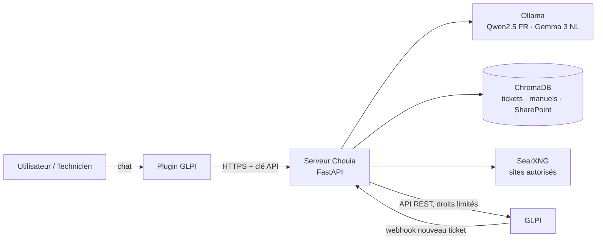

# Chouia — assistante informatique IA intégrée à GLPI

> Projet réalisé par **Jennifer Nevado Morgado** pendant son stage de technicienne en programmation (ISFCE), au service informatique de la commune de Saint-Gilles (Bruxelles), du 7 septembre au 28 novembre 2026.

**Chouia** est une assistante informatique bilingue (français / néerlandais) branchée sur **GLPI**, l'outil de tickets du service informatique. Elle aide les utilisateurs à régler eux-mêmes les problèmes simples, répond aux nouveaux tickets quand la solution est sûre et assiste les techniciens sur les tickets ouverts.

Tout tourne **sur un serveur local**, avec un modèle de langage open source, **sans service payant ni carte graphique** : les conversations ne partent pas chez un fournisseur d'IA extérieur.

> ℹ️ Le code de production appartient à l'administration et reste sur son dépôt privé. Ce dépôt présente le projet, son architecture et des **exemples de code réécrits** pour illustrer les techniques utilisées. Il ne contient aucune donnée, adresse, clé ou information interne.

---

## Ce que fait Chouia : trois rôles

| Rôle | Qui | Ce qu'il fait | Ce qu'il ne fait jamais |
|---|---|---|---|
| **1. Nouveaux tickets** | Déclenché automatiquement par GLPI (webhook) | Répond en un seul message avec des étapes **validées**, écrites par Python | Converser, donner une étape non validée |
| **2. Utilisateur** | Chat intégré à GLPI | Guide pas à pas (wifi, mot de passe, messagerie, imprimante…), puis prépare un ticket clair et le crée **avec l'accord** de l'utilisateur | Donner des gestes de technicien, changer des droits |
| **3. Technicien** | Chat ouvert depuis un ticket | Résumé, anciens cas semblables, procédures officielles, notes privées, traduction NL de la réponse | Modifier le ticket |

Règle commune : ne jamais mettre en danger un poste, un compte ou des données. En cas de doute, Chouia laisse la main au technicien.

## Architecture

Détails : [docs/architecture.md](docs/architecture.md)

## Technologies

| Domaine | Outils |
|---|---|
| Serveur | Python, **FastAPI**, systemd, Ubuntu (VM), HTTPS |
| IA | **Ollama** (qwen2.5:7b pour le français, gemma3:12b pour le néerlandais), embeddings **bge-m3** |
| Recherche (RAG) | **ChromaDB** : anciens tickets, manuels d'équipement, documents SharePoint |
| Internet | **SearXNG** auto-hébergé, limité à des sites autorisés |
| Données personnelles | **spaCy** FR/NL pour masquer les noms dans les anciens tickets |
| Intégration | **API REST GLPI**, webhooks, plugin PHP (développé par le maître de stage) |
| Qualité | Git, GitHub, crochet pre-commit, scénarios de test FR/NL |

## Ma contribution

J'ai mené le projet **de l'analyse à la livraison** :

- **Analyse et conception** : besoins, architecture, sécurité, sources de connaissances, trois rôles (validées le 23 septembre).
- **Serveur et API** : FastAPI, contrôle des clés, limites de charge, journaux, service permanent.
- **Les trois rôles** : prompts par rôle et par langue, parcours guidés écrits et suivis par Python, contrôle des réponses (langue, étapes, sources).
- **Base de connaissances** : nettoyage et masquage de **3 215 anciens tickets**, recherche et indexation de **396 manuels d'équipement**, tri des documents SharePoint.
- **Sécurité** : filtre des demandes dangereuses, masquage des noms, interrupteurs (écriture GLPI désactivée par défaut, comptes de test).
- **Tests** : 153 scénarios FR/NL rejoués automatiquement, simulations sur de vrais tickets en lecture seule, tests en direct avec l'équipe.
- **Diagnostic** : identification de la cause d'un blocage du chat au branchement (contrôle CSRF côté GLPI).
- **Documentation** : manuel technique (99 pages), rapport de tests, guide utilisateur.

## Résultats

- Les **trois rôles** sont branchés dans GLPI et testés en direct (novembre 2026).
- Rôle 2 : séries de scénarios à 100 % « OK » avant le branchement, après correction de chaque écart.
- Rôle 3 en direct : réponse moyenne en **92 secondes** sur processeur seul.
- Architecture **modulaire** : le modèle, les prompts et les rôles se changent par configuration.

## Limites connues (et ce que j'en retiens)

- Sans carte graphique, une réponse prend 1 à 3 minutes.
- Le ton du rôle 3 et la prise en compte du ticket ouvert demandent encore des réglages.
- Leçon principale : **tester plus tôt avec la vraie interface** pour détecter les problèmes d'intégration avant le branchement.

## Exemples de code

Le dossier [`exemples/`](exemples/) contient des extraits **réécrits et simplifiés** qui montrent les techniques du projet :

| Fichier | Technique |
|---|---|
| [`api_minimale.py`](exemples/api_minimale.py) | API FastAPI protégée par clé, choix du rôle |
| [`modele_ollama.py`](exemples/modele_ollama.py) | Appel du modèle local, un modèle par langue |
| [`recherche_rag.py`](exemples/recherche_rag.py) | Recherche par le sens dans ChromaDB |
| [`masquage.py`](exemples/masquage.py) | Masquage des noms avec spaCy |
| [`securite.py`](exemples/securite.py) | Filtre des demandes dangereuses |
| [`roles.yaml`](exemples/roles.yaml) | Configuration des rôles et interrupteurs |

## Documentation

- [Architecture](docs/architecture.md)
- [Les trois rôles](docs/roles.md)
- [Sécurité et données personnelles](docs/securite.md)
- [Tests](docs/tests.md)

---

**Contact** : Jennifer Nevado Morgado — technicienne en programmation, infographiste
