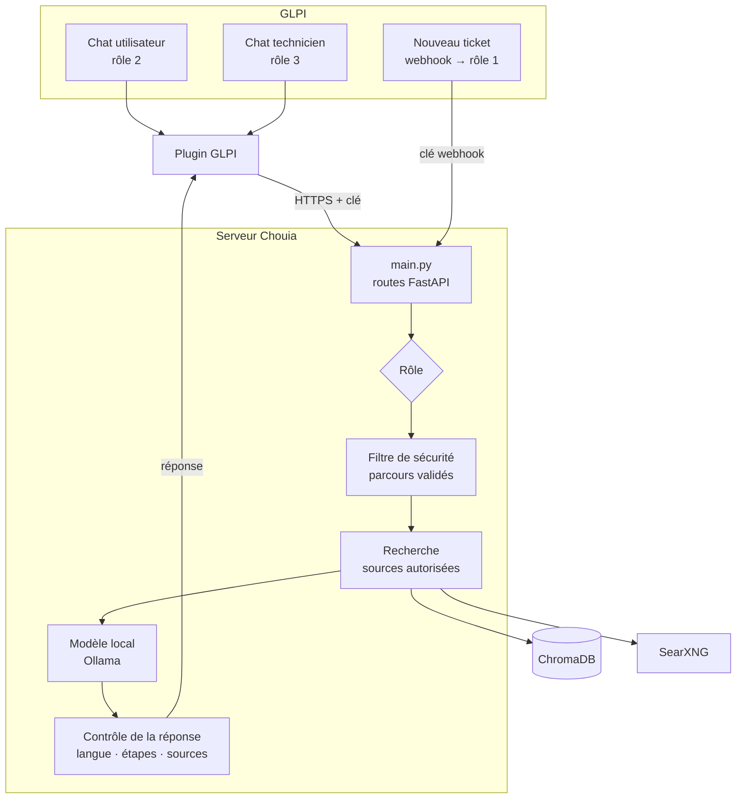

# Architecture

## Vue d'ensemble

Chouia est un serveur **FastAPI** installé sur une machine virtuelle Ubuntu. Le plugin GLPI lui envoie les demandes ; le navigateur ne parle jamais directement au modèle et ne voit jamais la clé de l'API.

## Cycle d'une demande (rôles 2 et 3)

1. L'utilisateur ou le technicien écrit dans le chat du plugin.
2. Le plugin transmet la demande au serveur avec la clé, le rôle et la question.
3. Le serveur vérifie la clé et le compte, puis choisit le rôle.
4. Python applique le filtre de sécurité et les parcours validés.
5. Python cherche dans les sources autorisées pour ce rôle et prépare le contexte.
6. Le modèle rédige la réponse.
7. Python contrôle la réponse (langue, étapes, sources), puis la renvoie au plugin.

## Rôle 1 : nouveaux tickets

1. GLPI envoie le numéro du ticket par webhook.
2. Chouia lit le ticket en **lecture seule**.
3. Si des étapes validées correspondent au problème, **Python écrit tout le message** : le modèle ne rédige rien.
4. Sinon, Chouia ne répond pas et un technicien prend le ticket.

## Choix techniques

| Choix | Pourquoi |
|---|---|
| Modèle local (Ollama) | Pas de données envoyées à l'extérieur, gratuit |
| Un modèle par langue | Qwen2.5 meilleur en français, Gemma 3 meilleur en néerlandais (essais comparatifs) |
| Python écrit les étapes critiques | Le modèle peut se tromper ; les étapes validées ne doivent pas être réinventées |
| Configuration YAML | Changer de modèle, de prompt ou de rôle sans toucher au code |
| Interrupteurs | Écriture dans GLPI désactivée par défaut, activée seulement après accord |

## Organisation du code (production)

| Dossier | Contenu |
|---|---|
| `main.py` | Application FastAPI, routes, contrôle des clés |
| `core/` | Logique : rôles, GLPI, recherche, sécurité, masquage, modèle |
| `config/` | Réglages YAML : rôles, paramètres, parcours, sites autorisés |
| `prompts/` | Consignes du modèle par rôle et par langue |
| `outils/` | Indexation, scénarios de test, rapports |
| `tests/` | Scénarios par rôle |
